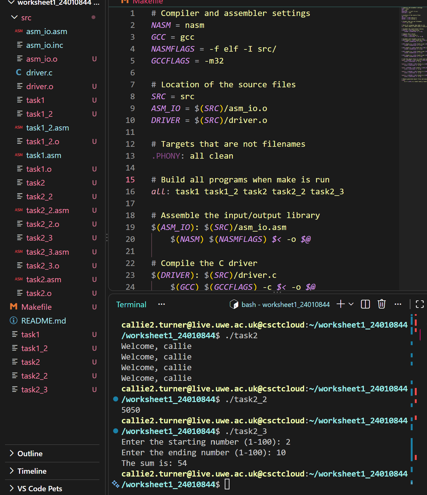
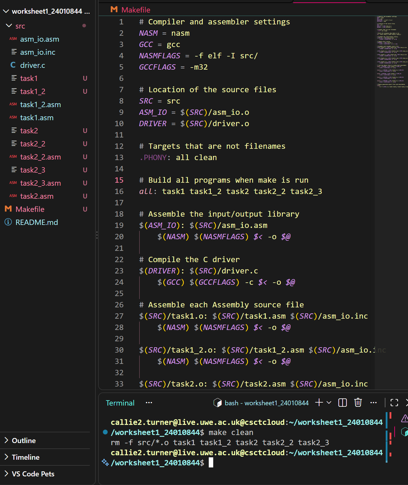
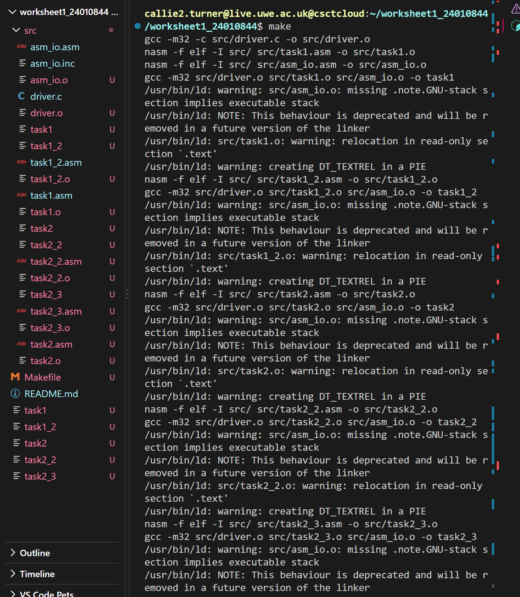

# Operating Systems Worksheet 1
## Assembly Programming

This repository contains the programs completed for Operating Systems Worksheet 1. The programs use Assembly language to perform calculations, handle user input, work with arrays and automate compilation using a Makefile.

---

## Task 1.1 – Adding Two Integers

### Aim

The aim of this program is to add two integers stored in memory and display the result.

### How the Program Works

The program stores two integers, 15 and 6, in the `.data` section. It loads the first integer into the EAX register, adds the second integer and stores the result in memory.

### Code Example

```asm
mov eax, [integer1]
add eax, [integer2]
mov [result], eax
```

The `mov` instruction moves values between registers and memory. The `add` instruction adds the two integers together, and the result is stored in the `result` variable.

### Implementation

- The `.data` section stores the two integers.
- The `.bss` section reserves memory for the result.
- The `.text` section contains the program instructions.
- The EAX register is used to perform the addition.
- `print_int` displays the result, and `print_nl` moves the output to a new line.

### Testing

The program was assembled, compiled and run in the terminal. The output was checked against the expected result.

| Test | First integer | Second integer | Expected output | Actual output | Result |
|---|---:|---:|---:|---:|---|
| Add two integers | 15 | 6 | 21 | 21 | Pass |


---

## Task 1.2 – Adding Two User-Entered Integers

### Aim

The aim of this program is to ask the user to enter two integers, add them together and display the result.

### How the Program Works

The program asks the user to enter two integers. It stores each number in memory before adding them together. The result is then displayed in the terminal.

### Code Example

```asm
call read_int
mov [integer1], eax

call read_int
mov [integer2], eax

mov eax, [integer1]
add eax, [integer2]
mov [result], eax
```

The `read_int` routine reads an integer entered by the user. The values are stored in memory, and `add` calculates their sum.

### Implementation

- The `.data` section stores the messages displayed to the user.
- The `.bss` section reserves memory for the integers and their result.
- `read_int` accepts the user's input.
- `mov` stores the input values in memory.
- `add` calculates the sum.
- `print_string` displays messages.
- `print_int` displays the numbers and result.
- `print_nl` moves the output to a new line.

### Testing

The program was assembled, compiled and run in the terminal. Two integers were entered to check that the program calculated the correct sum.

| Test | First integer | Second integer | Expected output | Actual output | Result |
|---|---:|---:|---:|---:|---|
| Add user-entered integers | 10 | 20 | 30 | 30 | Pass |


---

## Task 2.1 – Personalised Welcome Message

### Aim

The aim of this program is to ask the user for their name and how many times they want a welcome message to be displayed. The program checks that the number entered is greater than 50 and less than 100. If the number is outside this range, an error message is displayed.

### How the Program Works

**1. Asking for the user's name**

The program displays a message asking for the user's name. It then uses `read_char` to read the name one character at a time and stores the characters in memory.

```asm
mov eax, name_msg
call print_string

mov edi, user_name
mov ecx, 99
```

The EDI register points to the memory location where the name is stored. ECX is used to limit the number of characters read. The program stops reading when the user presses Enter or the character limit is reached.

**2. Asking for the number**

The program asks the user how many times the welcome message should be displayed. It uses `read_int` to read the number and stores it in `user_number`.

```asm
mov eax, number_msg
call print_string
call read_int
mov [user_number], eax
```

**3. Checking the input**

The number must be greater than 50 and less than 100. The program checks the value and displays an error message if it is 50 or below, or 100 or above.

```asm
cmp eax, 50
jle show_error

cmp eax, 100
jge show_error
```

The `cmp` instruction compares the number with the limits. The conditional jumps send the program to the error message when the input is invalid.

**4. Displaying the welcome message**

If the number is valid, the program uses a loop to display a personalised welcome message the requested number of times.

```asm
inc dword [counter]

mov eax, [counter]
cmp eax, [user_number]
jl welcome_loop
```

The counter increases after each message. The loop continues until the counter reaches the number entered by the user.

### Implementation

- `print_string` displays the prompts and messages.
- `read_char` reads the user's name.
- `read_int` reads the number of messages.
- The EDI register points to the memory used to store the name.
- The counter keeps track of how many messages have been displayed.
- Conditional jumps check whether the input is valid.
- A loop displays the welcome message the required number of times.

### Testing

The program was assembled using NASM, linked using GCC and run in the terminal. Different inputs were used to check that the program accepted valid numbers and rejected invalid ones.

| Test | Input | Expected result | Actual result | Result |
|---|---:|---|---|---|
| Valid lower limit | 51 | Display the welcome message 51 times | Welcome message displayed 51 times | Pass |
| Valid upper limit | 99 | Display the welcome message 99 times | Welcome message displayed 99 times | Pass |
| Below the allowed range | 50 | Display an error message | Error message displayed | Pass |
| Above the allowed range | 100 | Display an error message | Error message displayed | Pass |


---

## Task 2.2 – Creating an Array and Calculating Its Sum

### Aim

The aim of this program is to create an array containing 100 integers, fill it with the numbers 1 to 100 and calculate their total. The final result is displayed in the terminal.

### How the Program Works

**1. Creating the array**

The program reserves memory for 100 integers using `resd`. Each integer takes up four bytes.

```asm
numbers resd 100
```

The program also uses a counter to keep track of the current array position and a variable called `total` to store the sum.

**2. Filling the array**

The program uses a loop to fill the array with the numbers 1 to 100.

```asm
mov eax, [counter]
inc eax

mov ebx, [counter]
mov [numbers + ebx*4], eax
```

The counter starts at zero, so the program adds one to it to generate the number to store. The array index is multiplied by four to calculate the memory location of each integer.

**3. Calculating the sum**

After filling the array, the counter is reset to zero. A second loop reads each element and adds it to `total`.

```asm
mov ebx, [counter]
mov eax, [numbers + ebx*4]
add [total], eax
```

The loop continues until all 100 elements have been added together.

**4. Displaying the result**

Once the calculation is complete, the program displays the total using `print_int`.

```asm
mov eax, [total]
call print_int
call print_nl
```

### Implementation

- `resd 100` reserves memory for the 100 integers.
- The counter keeps track of the current array position.
- A loop fills the array with numbers from 1 to 100.
- A second loop adds each array element to `total`.
- The program uses `print_int` to display the final sum.

### Testing

The program was assembled using NASM, linked using GCC and run in the terminal. The output was checked to make sure that the sum of all the integers was correct.

| Test | Expected output | Actual output | Result |
|---|---:|---:|---|
| Sum of integers from 1 to 100 | 5050 | 5050 | Pass |


---

## Task 2.3 – Calculating the Sum of a User-Selected Range

### Aim

The aim of this program is to extend Task 2.2 by allowing the user to choose a starting number and an ending number. The program calculates the sum of the numbers within the selected range, including both endpoints.

### How the Program Works

**1. Creating and filling the array**

The program reserves memory for 100 integers and fills the array with the numbers 1 to 100, using a similar loop to Task 2.2.

```asm
numbers resd 100
```

Each integer occupies four bytes, allowing the program to access the values using their array positions.

**2. Asking the user for a range**

The program asks the user to enter a starting number and an ending number. It uses `read_int` to collect both values and stores them in `start_num` and `end_num`.

```asm
mov eax, start_msg
call print_string
call read_int
mov [start_num], eax
```

**3. Checking the range**

The program checks that both numbers are between 1 and 100. It also checks that the starting number is not greater than the ending number.

```asm
mov eax, [start_num]
cmp eax, 1
jl show_error
cmp eax, 100
jg show_error
```

If the range is invalid, the program displays an error message instead of calculating the sum.

**4. Calculating the sum**

The program converts the starting number into a zero-based array index by subtracting one. It then uses a loop to add the numbers within the selected range.

```asm
mov eax, [start_num]
dec eax
mov [counter], eax
```

The loop continues until all the numbers in the selected range have been added, including the ending number.

**5. Displaying the result**

After calculating the sum, the program displays the result using `print_int`.

For example, if the user enters 1 as the starting number and 5 as the ending number, the result is 15.

### Implementation

- The array stores the numbers from 1 to 100.
- `read_int` accepts the starting and ending numbers.
- The values are stored in `start_num` and `end_num`.
- Conditional jumps check whether the range is valid.
- The counter tracks the current array position.
- A loop adds the numbers within the selected range.
- `print_int` displays the final sum.

### Testing

The program was assembled using NASM, linked using GCC and tested in the terminal. Different ranges were entered to check that the program calculated the correct sums and rejected invalid ranges.

| Test | Starting number | Ending number | Expected result | Actual result | Result |
|---|---:|---:|---|---|---|
| Small range | 1 | 5 | 15 | 15 | Pass |
| Single number | 10 | 10 | 10 | 10 | Pass |
| Full range | 1 | 100 | 5050 | 5050 | Pass |
| Invalid starting number | 0 | 5 | Error message | Error message displayed | Pass |
| Invalid ending number | 5 | 101 | Error message | Error message displayed | Pass |
| Reversed range | 10 | 5 | Error message | Error message displayed | Pass |


---

## Task 3 – Makefile

### Aim

The aim of this task is to create a Makefile that automates the assembly, compilation and linking of all five programs. This means the programs can be built using one command instead of entering each command separately.

### How the Makefile Works

The Makefile uses NASM to assemble the Assembly source files and GCC to compile the C driver and link the object files into executable programs. The source files are stored in the `src` directory.

The `all` target builds the five programs:

- `task1`
- `task1_2`
- `task2`
- `task2_2`
- `task2_3`

The `clean` target removes the generated object files and executable programs while keeping the original source files.

### Implementation

- `NASM` defines the assembler used to assemble the programs.
- `GCC` defines the compiler and linker.
- `SRC` specifies the location of the source files.
- The individual targets assemble and link each program.
- The `all` target builds all five executables.
- The `clean` target removes the generated object files and executables.
- The `make` command runs the default `all` target.

### Testing

The Makefile was tested by running `make` from the project root directory. All five programs were built successfully. Each executable was then run to check that it worked as expected.

| Test | Command | Expected result | Actual result | Result |
|---|---|---|---|---|
| Build all programs | `make` | All five programs are built | All five programs built successfully | Pass |
| Remove generated files | `make clean` | Object files and executables are removed | Generated files removed | Pass |
| Rebuild programs | `make` | All five programs are built again | All five programs rebuilt successfully | Pass |

### Makefile and Build Output

The following screenshots show the Makefile and the output from building the programs.




### Cleaning Generated Files

The `make clean` command removes the generated object files and executable programs. This allows the programs to be rebuilt without keeping the previous build files.



### Rebuilding the Programs

After running `make clean`, the `make` command was run again to check that all five programs could be rebuilt successfully from the source files.



The commands used to build and clean the programs are:

```bash
make
make clean
```

---

## Files

The repository contains the following main files:

| File | Description |
|---|---|
| `Makefile` | Automates building and cleaning the programs |
| `README.md` | Documents the tasks, implementation and testing |
| `src/task1.asm` | Adds two integers stored in memory |
| `src/task1_2.asm` | Adds two integers entered by the user |
| `src/task2.asm` | Displays a personalised welcome message a specified number of times |
| `src/task2_2.asm` | Creates an array of 100 integers and calculates their sum |
| `src/task2_3.asm` | Calculates the sum of a user-selected range |
| `src/driver.c` | C driver used to run the Assembly programs |
| `src/asm_io.asm` | Contains the Assembly input/output routines |
| `src/asm_io.inc` | Contains the definitions used by the input/output routines |
