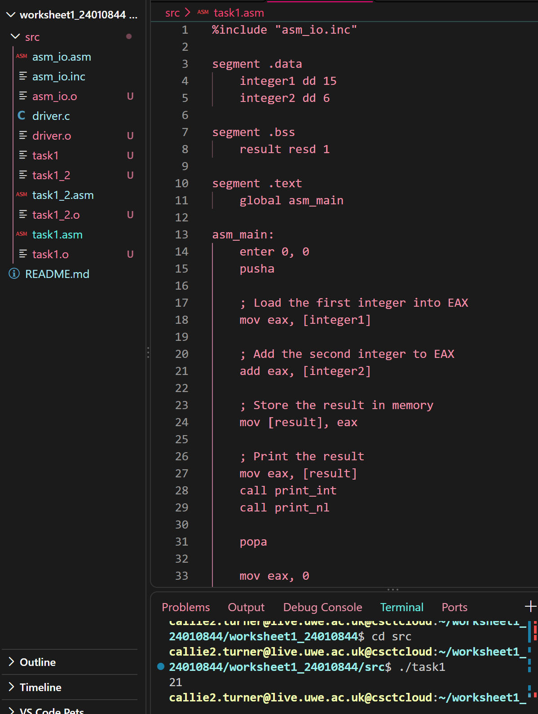
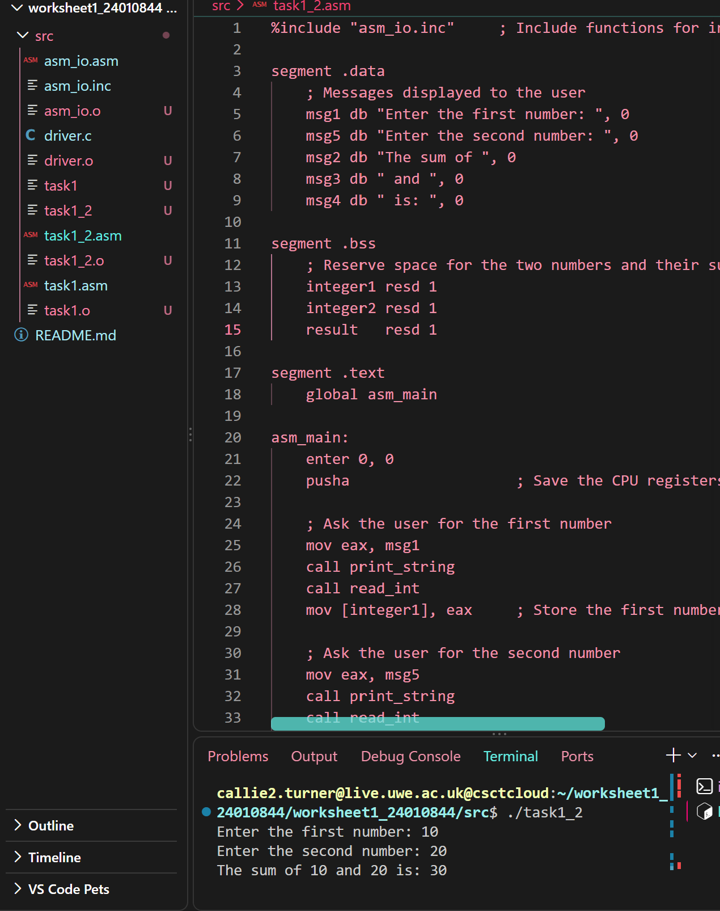
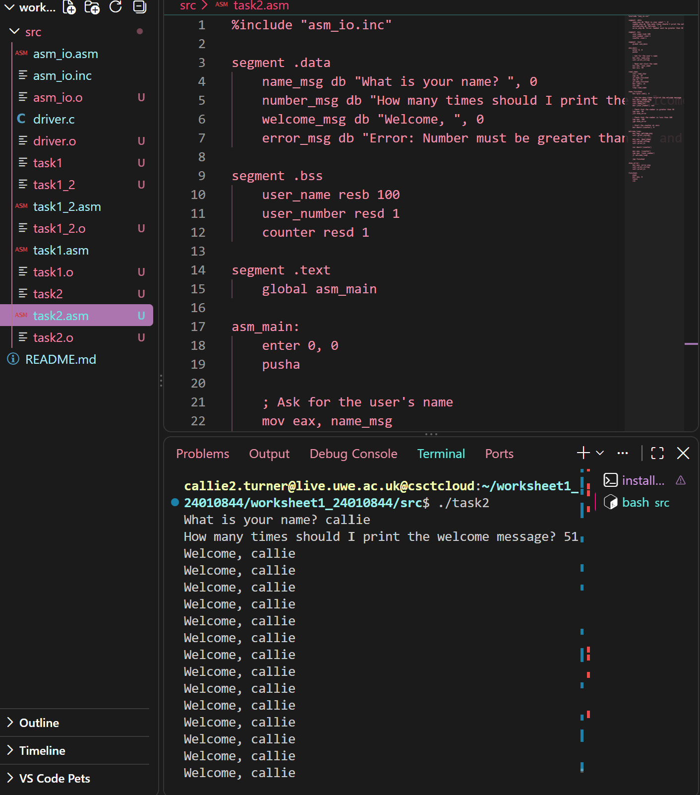
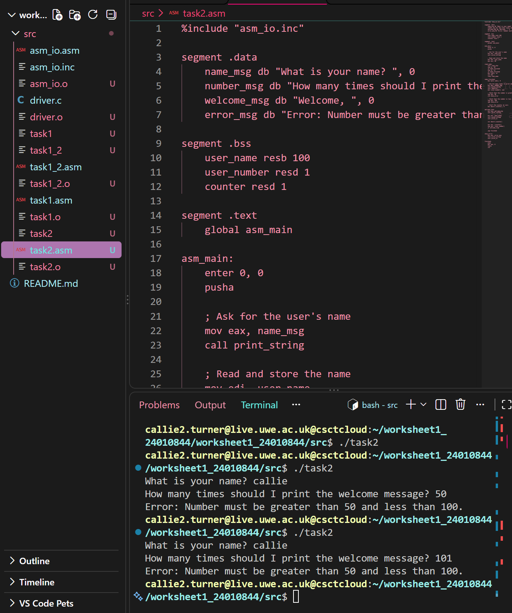
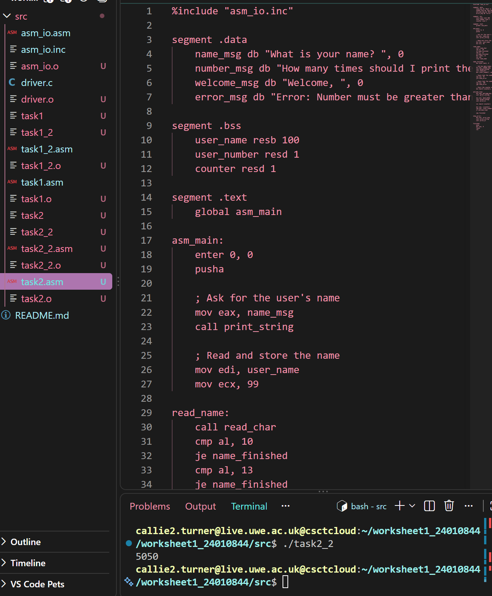
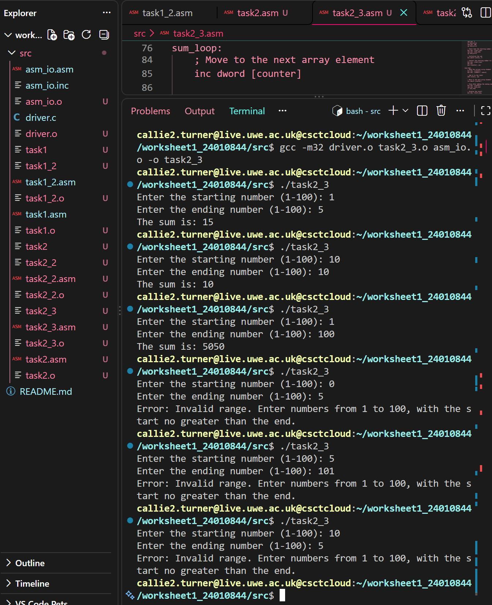
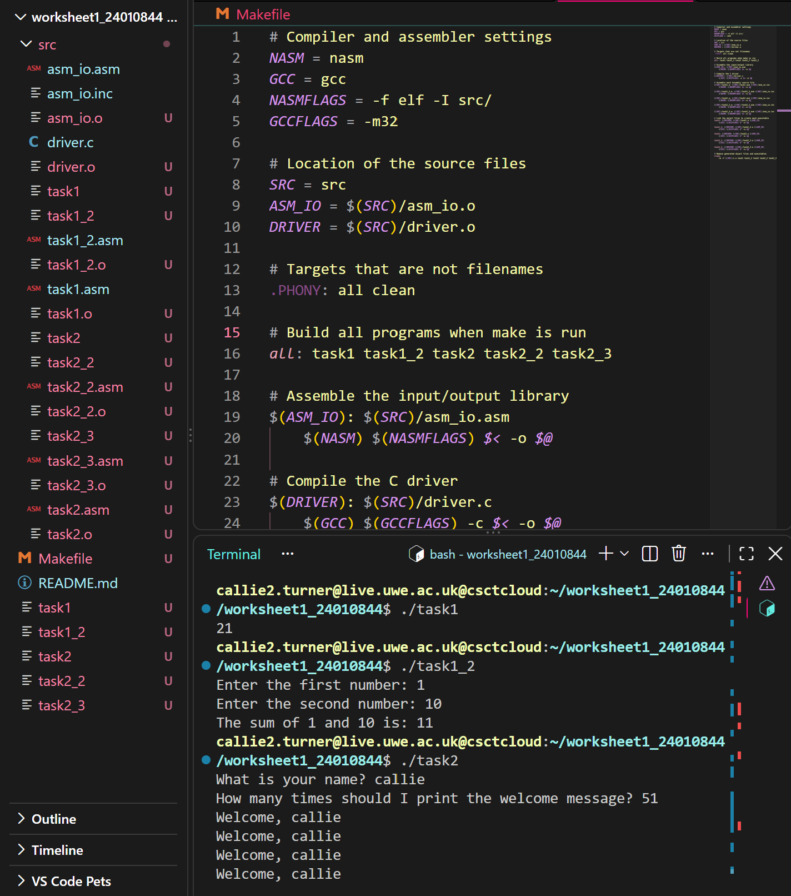

# worksheet1_24010844
# Operating Systems Worksheet 1

## Task 1.1 – Adding Two Integers

### Code Example

The following instructions load the first integer into the EAX register,
add the second integer, and store the result in memory.

```asm
mov eax, [integer1]
add eax, [integer2]
mov [result], eax
```

The `mov` instruction loads or stores values, while `add` performs the
addition. The result is stored in the `result` variable before it is
printed.

### Description
This program uses Assembly language to add two integers stored in memory.
The first integer is 15 and the second integer is 6. The program loads
the first integer into the EAX register, adds the second integer, and
stores the result in memory before displaying it.

### Implementation
- The `.data` section stores the two integers.
- The `.bss` section reserves memory for the result.
- The `.text` section contains the program instructions.
- The program uses `mov` to load and store values and `add` to calculate
  the sum.
- The result is displayed using `print_int`.

### Testing
The program was assembled, compiled, and executed successfully.

**Test values:**
- First integer: 15
- Second integer: 6
- Expected result: 21
- Actual result: 21



---

## Task 1.2 – Adding Two User-Entered Integers

### Code Example

The program reads two integers, stores them in memory, and adds them.

```asm
call read_int
mov [integer1], eax

call read_int
mov [integer2], eax

mov eax, [integer1]
add eax, [integer2]
mov [result], eax
```

The `read_int` routine accepts an integer from the user. Each value is
stored in memory, and the `add` instruction calculates the sum.

### Description
This program asks the user to enter two integers, adds them together,
and displays the calculation and the sum.

### Implementation
- The `.data` section stores the messages displayed to the user.
- The `.bss` section reserves memory for the two integers and their sum.
- `read_int` accepts the user's input.
- `mov` stores the input values in memory.
- `add` calculates the sum.
- `print_string` displays messages.
- `print_int` displays the numbers and the result.
- `print_nl` moves the output to a new line.

### Testing
The program was assembled, compiled, and executed successfully.

**Test values:**
- First integer: 10
- Second integer: 20
- Expected result: 30
- Actual result: 30



---

Task 2.1 – Personalised Welcome Message
Aim

The aim of this program is to ask the user for their name and how many times they want a welcome message to be displayed. The program checks that the number entered is greater than 50 and less than 100. If the number is outside this range, an error message is displayed.

How the Program Works

1. Asking for the user's name

The program uses print_string to display a prompt asking for the user's name. It then uses read_char to read the name one character at a time and stores each character in memory.

mov eax, name_msg
call print_string

mov edi, user_name
mov ecx, 99

The EDI register points to the location where the name is stored, and ECX limits the number of characters read. The program stops reading when the user presses Enter or the character limit is reached.

2. Asking for the number

The program asks the user how many times the welcome message should be displayed. It uses read_int to accept an integer and stores the result in user_number.

mov eax, number_msg
call print_string
call read_int
mov [user_number], eax

3. Validating the number

The program checks whether the number is within the required range. The number must be greater than 50 and less than 100.

cmp eax, 50
jle show_error

cmp eax, 100
jge show_error

The cmp instructions compare the number against the limits. The conditional jumps send the program to the error message if the number is 50 or below, or 100 or above.

4. Printing the welcome message

If the number is valid, the program starts a counter at zero and enters a loop.

mov dword [counter], 0

Each time the loop runs, the program prints Welcome, followed by the user's name. The counter increases by one after each message. The loop continues until the counter reaches the number entered by the user.

inc dword [counter]

mov eax, [counter]
cmp eax, [user_number]
jl welcome_loop

This ensures that the welcome message is displayed the requested number of times.

Testing

The program was assembled and linked successfully using NASM and GCC. It was then run from the terminal to check its behaviour.

Test	Input	Expected result
Valid lower limit	51	Prints the welcome message 51 times
Valid upper limit	99	Prints the welcome message 99 times
Below the allowed range	50	Displays an error message
Above the allowed range	100	Displays an error message




Task 2.2 – Creating an Array and Calculating Its Sum
Aim

The aim of this program is to create an array containing 100 integers, fill it with the numbers 1 to 100, and calculate the sum of all the elements. The final result is printed to the terminal.

How the Program Works

1. Creating the array

The program reserves memory for 100 integers using resd. Each integer occupies four bytes.

numbers resd 100

The program also uses a counter to keep track of the current array position and a variable called total to store the sum.

2. Initialising the array

The program starts the counter at zero and uses a loop to fill the array with numbers from 1 to 100.

mov eax, [counter]
inc eax

mov ebx, [counter]
mov [numbers + ebx*4], eax

The counter represents the array index, starting at zero. The program adds one to the counter value to generate the number stored at that position. Multiplying the index by four calculates the correct memory offset for each integer.

3. Calculating the sum

After filling the array, the counter is reset to zero. A second loop reads each element and adds it to total.

mov ebx, [counter]
mov eax, [numbers + ebx*4]
add [total], eax

The loop continues until all 100 elements have been added together.

4. Displaying the result

Once the calculation is complete, the program prints the total using print_int, followed by a newline.

mov eax, [total]
call print_int
call print_nl
Testing

The program was assembled using NASM, linked using GCC, and executed in the terminal.

Test	Expected output
Sum of integers from 1 to 100	5050



Task 2.3 – Calculating the Sum of a User-Selected Range
Aim

The aim of this program is to extend Task 2.2 by allowing the user to choose a starting and ending number. The program calculates the sum of all the numbers within the selected range, provided the range is valid.

How the Program Works

1. Creating and filling the array

The program reserves space for 100 integers and fills the array with the numbers 1 to 100, using a loop similar to the one in Task 2.2.

numbers resd 100

Each element occupies four bytes, allowing the program to access each number using its array index.

2. Asking the user for a range

The program asks the user to enter a starting number and an ending number. It uses read_int to collect both values and stores them in start_num and end_num.

mov eax, start_msg
call print_string
call read_int
mov [start_num], eax

3. Validating the range

The program checks that both numbers are between 1 and 100. It also checks that the starting number is not greater than the ending number.

mov eax, [start_num]
cmp eax, 1
jl show_error
cmp eax, 100
jg show_error

If the range is invalid, the program displays an error message instead of calculating the sum.

4. Calculating the sum

The program converts the starting number into a zero-based array index by subtracting one. It then uses a loop to add each element within the selected range to total.

mov eax, [start_num]
dec eax
mov [counter], eax

The loop continues until all numbers in the selected range, including the ending number, have been added.

5. Displaying the result

After calculating the sum, the program displays the result using print_int.

For example, if the user enters 1 as the starting number and 5 as the ending number, the result is 15.

Testing

The program was assembled using NASM, linked using GCC and tested in the terminal.

Test	Starting number	Ending number	Expected result
Small range	1	5	15
Single number	10	10	10
Full range	1	100	5050
Invalid starting number	0	5	Error message
Invalid ending number	5	101	Error message
Reversed range	10	5	Error message



## Task 3 – Makefile

A Makefile was created to automate the building of all five Assembly programs. This means the programs can be compiled and linked using one command instead of entering each command separately.

The Makefile uses NASM to assemble the Assembly source files and GCC to compile the C driver and link the object files into executable programs.

The `all` target builds all five programs:
- `task1`
- `task1_2`
- `task2`
- `task2_2`
- `task2_3`

The `clean` target removes the generated object files and executable programs.

### Testing

The Makefile was tested by running `make` from the project root directory. All five executable programs were built successfully. Each executable was then run to check that the programs worked as expected.

To build all programs, run:

    make

To remove the generated files, run:

    make clean




## Files

- `src/task1.asm` – Assembly program for Task 1.1.
- `src/task1_2.asm` – Assembly program for Task 1.2.
- `src/driver.c` – C driver used to run the Assembly programs.
- `src/asm_io.asm` – Assembly input/output routines.
- `src/asm_io.inc` – Assembly input/output definitions.
